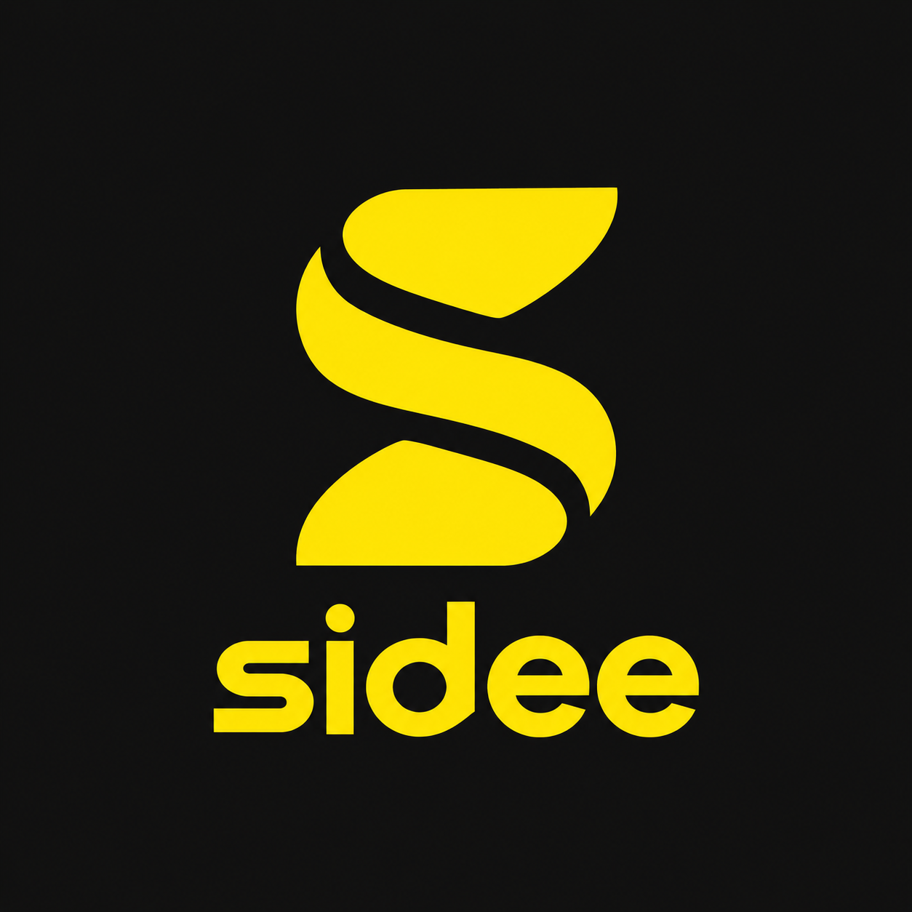

<p align="center"></p>

# Sidee Web

**Your TV, your freedom.**

Sidee is an open-source tool that helps people make more of the TVs they already own. This React application provides a browser dashboard to connect to compatible VIDAA TVs and manage web-app launcher tiles without command-line setup or coding.

## Features

- **TV Discovery & IP Probing**: Locate VIDAA TVs on your local network or verify a specific IPv4 address.
- **PIN-Authorized Pairing**: Consent-based 4-digit PIN security authorization directly from the TV.
- **Curated App Catalog**:
  - **Nuvio**: Browse and stream your library
  - **Stremio**: TV-first interface with D-pad navigation and streaming server linking
  - **Jellyfin**: Connect your media from your Jellyfin server
- **Custom Apps**: Register custom web apps with customizable names, URLs, icons, and categories.
- **Launcher Management**: Install apps directly to the TV launcher or launch them immediately on screen.
- **Setup Diagnostics**: Built-in verification checklist for local network, paired sessions, TV reachability, and dashboard status.
- **Phone Access**: Local QR code generation to use the dashboard on a smartphone.

## Development

```bash
# Install dependencies
npm install

# Start development server
npm run dev

# Build for production
npm run build
```

## License

MIT — see [LICENSE](LICENSE). Sidee is an independent project and is not affiliated with TV manufacturers.
